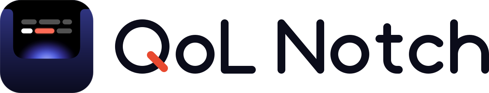
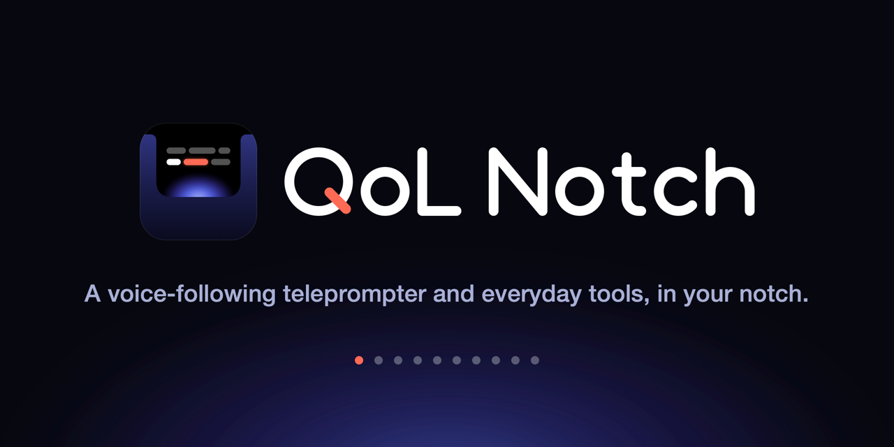
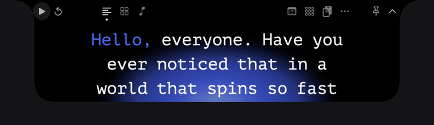

<p align="center">
  <picture>
    <source media="(prefers-color-scheme: dark)" srcset="Branding/logo-horizontal-dark.svg">
    
  </picture>
</p>

<p align="center">
  <b>Your notch, but useful.</b><br>
  A free, open-source Dynamic Island for the Mac, built around a teleprompter that follows your voice.
</p>

<p align="center">
  <a href="https://github.com/u6610909/QoL-notch/releases/latest"></a>
  
  
</p>

<p align="center">
  
</p>

<!-- Demo GIF goes here: <p align="center"></p> -->

"QoL" is short for quality of life: lots of small, useful things, right where you already look.

## Download

1. Download the `.zip` from the [latest release](https://github.com/u6610909/QoL-notch/releases/latest) and unzip it.
2. Move **QoL Notch.app** to Applications.
3. The first time, **right-click the app → Open**. It isn't notarized by Apple yet, so a normal double-click is blocked once.

If macOS still won't open it:

```bash
xattr -dr com.apple.quarantine "/Applications/QoL Notch.app"
```

## Teleprompter

- **Voice Follow:** the script moves as you speak and waits when you stop. Recognition stays on your Mac where it's supported.
- **Auto Scroll:** no mic needed. Pick a speed from 60 to 240 words a minute; it pauses a little at commas, sentence ends and new paragraphs.
- **Thai first:** Thai and mixed Thai/English scripts are split into words and followed, even though Thai has no spaces.
- **Hidden from screen sharing:** your script sits at the notch, right under the camera, and doesn't show up in Zoom, Meet or recordings.
- **Team scripts:** start a line with `@Name:` and each speaker gets a "You're next" cue before their turn.
- **Rehearse:** after each run you see your time, words per minute, pauses, time per section and filler words.
- **Phone remote:** scan a QR code and control it from your phone's browser. No app needed.
- **Import notes:** open a Markdown or Obsidian note (⌘O) and only the speakable text is kept.
- Click any word to jump to it, or detach the prompter as a free panel you can drag and resize.

## The island

The island rests inside the notch and opens when you point at it. Pick up to six tools to sit beside the notch, in your order:

| Tool | What it does |
|---|---|
| **Home** | Music, what's next, weather or system load at a glance |
| **Now playing** | Works with any app, browser tabs too. Drag the progress bar, skip, shuffle; the cover spins as a vinyl record and colours the glow |
| **Calendar** | Today and the days ahead |
| **Camera** | A quick mirror before a call, with a flip button |
| **Notes** | A quick note, with an optional Touch ID lock |
| **Timer** | Counts down beside the notch while it rests |
| **Clipboard** | History that survives restarts, screenshots included |
| **Shelf** | Drop files on the notch to hold them, then drag them out or AirDrop them |
| **Apps** | A small launcher |

While it rests, the notch speaks up for a moment when something matters: a timer ending, a meeting a minute away, plugging in, low battery, and (if you want) volume and brightness. New screenshots drop out of the notch so you can drag them straight into a chat.

**Experimental:** music controls on the lock screen. Off by default, because it uses parts of macOS that an update could break.

## Make it yours

Five built-in themes, or build your own: accent colour, glow colour, script font and size. Save themes as small `.qoltheme` files to share with friends.

## Build from source

Requires macOS 14+ and the Xcode command line tools.

```bash
./scripts/bundle.sh
open "build/QoL Notch.app"
```

Run the tests with `swift test`. The logo and app icon are drawn from numbers in `scripts/make_logo.py`; run `./scripts/render_logo.sh` after changing them.

The first time you press Start in Voice Follow, macOS asks for microphone and speech recognition access.

## Contributing

Issues and pull requests are welcome. If QoL Notch is useful to you, a ⭐ helps other people find it.

## License

MIT. See [LICENSE](LICENSE).
